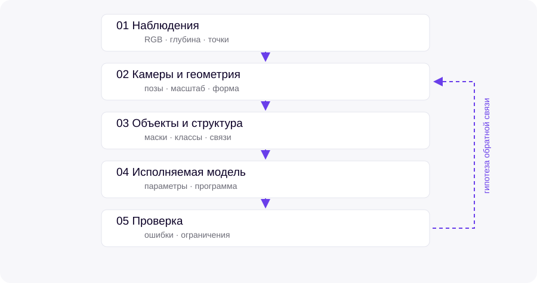

Реконструкцию удобно рассматривать как последовательность переходов между представлениями. Изображения дают наблюдения поверхностей; оценка камер связывает виды; геометрия описывает форму; распознавание выделяет объекты; структурированная модель связывает их с параметрами и отношениями.

{#fig-pipeline}

*Схема показывает план изложения. Стрелки не означают, что единая система уже реализована.*

Результат каждого этапа должен сопровождаться сведениями о системе координат, масштабе, видимости и неопределённости. Это делает возможным анализ ошибок между этапами.
